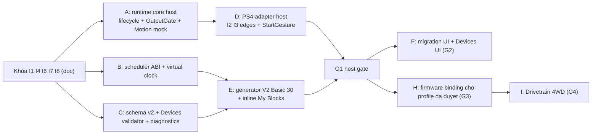

# Rà soát G0 — Blockly Product Spec V0.2

> **Ngày:** 10/11/2026 · **Issue:** #28 · **Spec:** `docs/BLOCKLY_PRODUCT_BLOCK_CATALOG_V0.2.md` @ `3475b57` (branch `docs/blockly-product-spec`)
> **Đối chiếu:** `main` @ `2a0705d`; tham khảo thêm nhánh chưa merge `codex/integrate-bach-ui` (fast100/Devices) vì nó chồng lấn phạm vi G2/G3.
> **Phạm vi:** chỉ đọc và rà soát. Không sửa source, không sửa spec, không chạy test/build/phần cứng. Đây là kết quả rà soát tài liệu, **không phải** phê duyệt thay chủ dự án.

## 0. Kết luận

**G0_BLOCKED.** Spec đã đủ chi tiết để duyệt về hướng thiết kế: lifecycle, sự kiện, latch/handle, AUTO và migration nhìn chung nhất quán với nhau. Có hai lý do chưa thể PASS:

1. Theo §9, G0 chỉ qua khi chủ dự án xác nhận §10 trong Issue #28. Hiện chưa có xác nhận đó, và người rà soát không được tự phê duyệt.
2. Còn 4 interface chưa khóa (B1–B4 ở §6), đều ảnh hưởng nhiều module. Nếu giao cho nhiều agent làm song song lúc này, mỗi agent sẽ tự hiểu theo một cách. Tất cả xử lý được bằng một bản vá tài liệu ngắn, không cần đổi code.

## 1. Phân loại quyết định

### 1.1. Đủ rõ, có thể khóa khi chủ dự án duyệt

| Chủ đề | Mục spec | Ghi chú đối chiếu main |
|---|---|---|
| Bốn trạng thái INIT/READY/RUN/FAULT, bảng chuyển trạng thái, FAULT không chặn compile/nạp | §2.1–2.2 | Main chỉ có `DISARMED/ARMED/FAULT` (`RobotController.h:12`). V2 là lớp lifecycle mới, không đổi tên enum cũ |
| CLEAR chỉ về READY, không bao giờ tự START | §2.2, §2.3 | Khớp quy tắc "clear không arm cùng tick" của main |
| Options giữ ≥1 s rồi nhả mới START; nhả sớm, stale, lệch neutral hoặc có Share thì hủy; giữ từ lúc boot/reconnect không tính | §2.3 | Main và fast100 dùng rising edge (`Ps4ControlMapping.h:13`). Spec đã xếp rising edge vào Legacy |
| Mỗi hat có tối đa 1 token pending; chỉ dispatch cạnh còn hiệu lực; thả hủy PRESS cũ; tie-break ổn định | §3.3 | Mới hoàn toàn, chưa có code |
| Wait/vòng lặp yield, deadline an toàn khi `millis()` wrap, mỗi RUN có generation riêng | §3.1–3.2 | Main dùng `delay()` (`arduino.js` `beginner_wait`). Basic V2 cấm `delay()` (§7.1) |
| Latch: lệnh motor giữ sau khi handler return; `Đợi` không tự dừng motor | §3.4 | — |
| Timed motion dùng handle (WAIT/NO_WAIT), timer cũ không được dừng lệnh mới, DRIVE là nhóm nguyên tử | §3.4 | — |
| AUTO tự hoàn thành khi hết script, pending và handle; latch không giữ RUN | §3.4 | — |
| Giới hạn AUTO lấy từ `autoMaxRunSeconds`, mặc định 15 s, khoảng 1–60, không có chế độ vô hạn; nếu trùng lúc hoàn thành thì deadline thắng | §3.4 | Profile chưa có trường trần (xem I8) |
| My Blocks inline tại từng chỗ gọi, đối số tính một lần, chặn đệ quy và vượt quota | §3.5 | Chưa có |
| Devices dùng ID ổn định, đổi alias không đổi ID, xóa thiết bị thì giữ block và báo lỗi, không tự remap | §4.1, §7.1 | Phù hợp AGENTS.md (không silently remap) |
| Basic 30 block, type `codelab_v2_*`, giữ type chuẩn khi hợp đồng không đổi | §5, §1 | Đếm lại được 6+8+5+6+3+2 = 30 |
| Migration opt-in, tạo bản sao, giữ bản gốc, không alias legacy sang hành vi V2 | §7.1 | Main chỉ có `FILE_VERSION = 1` (`App.jsx:22`) |
| GPIO47 trên V2 là M6 | §2.3, §4.1 | Đúng: `PINOUT.md:22` ghi M6_IN2 = GPIO47 |
| Ngưỡng watchdog/freshness 250 ms | §2.3, §9.2 | Main: `I2CFrame.h:8`, `RobotController.h:36`. Main tính đúng 250 ms vẫn là fresh; spec nên ghi rõ biên `≤250` |

### 1.2. Còn mâu thuẫn hoặc mơ hồ (cần sửa tài liệu hoặc chủ dự án quyết)

| # | Vấn đề | Vị trí | Hệ quả nếu để nguyên |
|---|---|---|---|
| M1 | **Safety monitor chạy thế nào chưa rõ.** §2.3 viết "tác vụ safety ưu tiên cao" (giống một task FreeRTOS chạy song song), nhưng §3.6 viết "M1=0 ngay tại lượt safety" và §5.7 viết "không block FreeRTOS" (giống một pha trong cùng vòng lặp). "Heartbeat" (§2.2, §9.2) cũng chưa nói ai phát, ai nhận | §2.2, §2.3, §3.1, §3.6, §9.2 | Agent firmware và agent scheduler/host-sim sẽ chọn hai mô hình đồng thời khác nhau, nhất là khóa cổng ghi output |
| M2 | **Mức diagnostics chưa khớp cổng compile.** §7.2 có WARN không chặn compile (`V2_ORPHAN_STACK`, `V2_MOTOR_MULTI_WRITER`, `V2_DRIVE_OWNERSHIP`), COUNTER và "BLOCK HARDWARE RUN". Main thì chặn **mọi** warning dạng chuỗi (`arduino-bridge.mjs:90,120`; `arduino.js:761–769`) | §7.2 | Hoặc WARN thực chất thành BLOCK, hoặc phải đổi hợp đồng bridge. "BLOCK HARDWARE RUN" chưa nói có chặn upload hay chỉ để firmware từ chối RUN |
| M3 | **Schema project v2 chưa có hình dạng cụ thể.** §4.1 mới liệt kê tên trường. §5.7 viết "Blockly JSON version 2", dễ lẫn với `languageVersion` của Blockly hoặc `version` của file project. Chưa nói migration các project trong localStorage (`codelab.projects.v1`) và `editorMode` | §4.1, §5.7, §7.1 | Generator, Devices UI và migration sẽ đọc/ghi ba schema khác nhau |
| M4 | **Đụng với nhánh chưa merge.** `codex/integrate-bach-ui` đã có `deviceConfigs[boardId]` `{version:1, motors, drivetrain, controller}` (`robot-devices.js:21`) và vẫn ghi file `version:1`. Spec không nhắc nhánh này | §4.1, §7.1 | Merge nhánh đó trước G2 sẽ tạo thêm một schema v1 "lai" mà migration phải xử lý |
| M5 | **fast100 tự START sau CLEAR.** Trên nhánh trên, `CodeLabFast4wd.h:270–273` dùng Options để vừa clear lỗi LINK vừa tự arm lại. Spec cấm CLEAR→START và chỉ coi fast100 là "rising edge legacy" | §2.2, §2.3 | Nguy cơ ai đó port nguyên hành vi này vào runtime V2. Cần ghi rõ đây là hành vi Legacy không được kế thừa |
| M6 | **Gán trục PS4 và dấu khác main.** Spec (§4.3, L3, D-P07..09): tiến=−rawLY, xoay=LX, ngang=RX, và chỉ đổi dấu trong adapter. Main `RobotController.h:53`: `vx=ly` (không đảo Y), `vy=lx`, `omega=rx`, tức ngang=LX, xoay=RX, và dấu vy/omega ngược với quy ước học sinh. fast100 hoán đổi LX/RX nên khớp spec về trục, còn dấu chưa có số đo | §4.3, §7.3, §8 L3 | Nếu dùng lại `RobotController` cho V2 sẽ bị đổi dấu hai lần hoặc sai trục |
| M7 | **Chưa định nghĩa nguồn CLEAR.** Main dùng PS rising edge để clear; spec chặn/ẩn nút PS cho học sinh và chỉ viết "CLEAR riêng / control-plane" | §2.2, §5.3, §6 D-P14 | G3 không có cử chỉ CLEAR để thử |
| M8 | Chưa định nghĩa: nhấn Options khi đang RUN/FAULT làm gì; giữ Options có giới hạn tối đa không (kẹt nút 30 s rồi nhả vẫn START) | §2.3 | Hành vi biên do agent tự chọn |
| M9 | J01–J04 (My Blocks) chưa có tên type. Theo quy tắc §1, ngữ nghĩa inline+wait và tham số chỉ là số là "đổi hành vi", nên không nên dùng thẳng `procedures_*` | §6, Phụ lục A | G1 spike không biết sinh code cho type nào |
| M10 | Chưa nói lệnh motor Basic có ramp/slew hay không, và giá trị mặc định của `cfg.maxDutyPercent`. Main có ramp 1.0/s và `speedLimit=0.5` | §4.1, §3.4 | Không biết nghiệm thu "M1=50% ngay" (§3.6) hay "tăng dần" |
| M11 | Frame I²C chỉ có sequence 7 bit, **không có session** (`I2CFrame.h:14`), trong khi §3.3 yêu cầu lọc "theo sequence và session". Ở 100 Hz, sequence quay vòng sau khoảng 1,28 s | §3.3 | Adapter phải tự sinh session (ví dụ khi `connected` 0→1 hoặc khi I²C lỗi). Cần ghi thành hợp đồng |

### 1.3. Cần kiểm chứng (không chặn G0/G1; chặn G3/G4)

- Dấu thật của trục LY/LX/RX qua D1 và bridge: đẩy lên ra giá trị âm hay dương (§4.3 hiện chỉ là giả định).
- Chu kỳ report/poll, xung nút ngắn bị mất, sequence wrap/reset trên đúng D1 (§3.3 mục 5).
- Profile phần cứng chính xác của board 4WD đã thử (16 MB, PSRAM tắt, I²C 0x30): main chưa có profile nào có capability PS4 I²C, nên mọi block PS4 S1 đều bị gate trên main.
- Truth table driver: RZ7899 (V1) và TMI8260 (V2, theo PINOUT); thời gian dừng vật lý; output khi CPU treo; watchdog/reset; công tắc ngắt nguồn động lực (§2.3 HW_VERIFY).
- Nút START vật lý trên board: chưa chọn, BOOT/GPIO0 chưa được phép. Trần AUTO theo profile.
- Mọi ngưỡng §9.2 (16 script, 1024 op, 256 op/tick, 2 ms, 16 KiB RAM, 64 KiB flash) mới là đề xuất, chưa benchmark.

## 2. API chung giữa scheduler, generator, Devices và firmware

Các tên dưới đây là **đề xuất để khóa**, chưa có trong code.

| ID | Interface | Producer → Consumer | Nội dung tối thiểu cần khóa |
|---|---|---|---|
| I1 | `LifecycleState` + `FaultCode` | firmware runtime → scheduler, generator (reporter), UI | Enum `INIT/READY/RUN/FAULT`; danh sách mã `V2_*` loại RUNTIME/FAULT; quy tắc CLEAR/START; tách biệt với `robot::State` cũ |
| I2 | `ControlPlane` (StartGesture/Stop/Clear) | PS4 adapter / nút board / web → lifecycle | Đầu vào: snapshot đã kiểm freshness. Đầu ra: `startRequested`, `stopRequested`, `clearRequested`. Bao gồm cấu hình nguồn START (`OPTIONS_HOLD` / `BOARD_BUTTON` / none) và tham số giữ (≥1 s, có hay không giới hạn tối đa) |
| I3 | `Ps4Snapshot` + `EdgeSource` | PS4 adapter → scheduler (event) + reporter | `{fresh, session, seq, pressed[btn], edgeGeneration[btn], axesStudent{forward,right,cw}}`; chỉ adapter được đổi dấu; Options/Share/PS bị tách khỏi luồng sự kiện học sinh |
| I4 | `OutputGate` / `MotorSink` | runtime safety → motion | `lock()` phải chạy trước cleanup; `write(channel,duty)` bị từ chối khi gate khóa hoặc sai RUN generation. Host dùng mock, firmware bọc driver thật |
| I5 | `MotionService` (owner/handle) | script đã sinh → runtime | `run/setPower/stop(channel)`, `drive(fwd,right,cw)`, `startTimed(…, WAIT|NO_WAIT) → handle`, `cancelAll()`; pool cố định; trả kết quả cho waiter (`COMPLETED/CANCELLED`); `activeHandles()` để biết AUTO đã hoàn thành chưa |
| I6 | `Scheduler` ABI cho code sinh ra | generator → runtime | Mỗi script: `struct {pc, frame, deadline}` + `tick(now)→{YIELD,DONE,WAIT_HANDLE}`; đăng ký hat (`WHEN_RUN`, `PRESSED(btn)`, `RELEASED(btn)`) theo `scriptUid`; quota op/tick; generation; `isIdle()` |
| I7 | `Diagnostic` | validator/generator → UI, bridge | `{code, severity: WARN|BLOCK|BLOCK_HW_RUN|RUNTIME|COUNTER, blockId?, deviceId?, message_i18n}`. Bridge chặn theo `severity`, không chặn theo việc có chuỗi hay không. Cách tương thích với `warnings[]` hiện tại |
| I8 | `ProjectV2` + `DevicesV2` + `BoardCapabilities` | UI/migration → generator, validator, firmware config | JSON schema có version: `boardId, runMode, startSource, autoMaxRunSeconds, devices[], motorRoles, invert, limits, sensorMap, editorMode`, cùng nơi lưu `scriptUid`. Profile bổ sung capability: `ps4I2c`, `motorBackendVerified`, `autoMaxRunCeiling`, `startButton`, `statusLed` |
| I9 | `LogSink` | script → sink | `tryLogLine` có giới hạn 128 B/dòng, queue 1 KiB, bộ đếm dropped, drain không chặn |

## 3. Thứ tự module và interface cần khóa trước khi giao nhiều agent

1. **Khóa trước khi chia việc** (tài liệu, chỉ một người làm): I1, I4, I6, I7, I8, và mô hình safety ở M1. Không cần đợi phần cứng.
2. **Có thể song song sau bước 1:** A (runtime core host), B (scheduler ABI/virtual clock), C (schema/validator/diagnostics). Các module này chỉ gặp nhau qua I1/I4/I6/I7/I8.
3. **Phụ thuộc:** D cần I2/I3 (khóa trước khi bắt đầu D); E cần B và C; G1 cần A+B+D+E.
4. **Sau G1:** F (UI và migration) và H (firmware). H bị chặn cho đến khi có profile phần cứng đã duyệt và tách khỏi code fast100.
5. Quy tắc chung cho mọi agent: không sửa `RobotController`, `Ps4ControlMapping`, `MecanumMixer`, firmware V1/V2 hay PS4 bridge đã được nghiệm thu. Nếu cần thì tạo module V2 mới (ví dụ `firmware/libraries/CodeLabRuntimeV2/`, `src/v2/…`).

## 4. Bộ acceptance tests tối thiểu

Mỗi test đều phải chạy và có log thì mới được tính PASS (theo AGENTS.md).

### G1 — host, virtual clock, mock (không cần phần cứng)

| ID | Ca | Kỳ vọng |
|---|---|---|
| G1-01 | Kịch bản X/O §3.6 | O được dispatch trước khi X resume; M1: 50% từ 0 ms, về 0 ở 2000 ms |
| G1-02 | STOP lúc 750 ms | M1=0 ở lượt safety; sau mốc 2000 ms không còn continuation hay callback nào chạy |
| G1-03 | X nhấn/thả/nhấn/thả ở 0/100/200/300 ms | Chỉ có 1 lệnh 50%; token PRESS lúc 200 ms bị hủy; M1=0 |
| G1-04 | Gửi dồn 100 cạnh khi handler đang bận | Mỗi hat tối đa 1 pending, counter coalesce tăng |
| G1-05 | Report trùng/stale/seq wrap 127→0/session mới | Không sinh cạnh giả; session mới lấy mẫu đầu làm baseline |
| G1-06 | Latch | M1 giữ 50% sau khi handler return; RELEASE thì dừng; nút giữ sẵn lúc vào RUN không tạo cạnh |
| G1-07 | AUTO, timed 1 s, WAIT và NO_WAIT | Về READY/0 ở 1000 ms; với NO_WAIT script đã return trước đó |
| G1-08 | AUTO `forever` / deadline trùng lúc hoàn thành | FAULT `V2_AUTO_MAX_RUNTIME` đúng 15 s (mặc định); deadline thắng |
| G1-09 | `autoMaxRunSeconds` = 0, 61, 1.5, thiếu trường | 0/61/1.5 bị BLOCK `V2_AUTO_RUN_LIMIT_INVALID`; thiếu trường lấy 15 (hoặc trần profile nếu thấp hơn) |
| G1-10 | Lệnh mới ghi đè handle đang có waiter; STOP khi đang có waiter | Ghi đè: waiter resume 1 lần với kết quả CANCELLED. STOP: không resume |
| G1-11 | DRIVE đang chạy rồi `motorRun(M1)` | Các kênh M2..M4 về 0 trước khi áp dụng lệnh mới |
| G1-12 | Cạn handle pool | FAULT an toàn, output = 0 |
| G1-13 | My Blocks: 2 chỗ gọi, wait lồng trong repeat→if→con | Đối số chỉ tính 1 lần, counter đúng, không lặp side effect; đệ quy và vượt quota bị BLOCK |
| G1-14 | Vòng lặp rỗng `forever` | Script khác vẫn được chạy; mỗi tick ≤256 op |
| G1-15 | Wrap `millis()` (bắt đầu ở 0xFFFFF000) | Deadline đúng |
| G1-16 | Serial sink đầy/không có sink/dòng >128 B | Bỏ dòng, tăng counter dropped, STOP vẫn đạt budget |
| G1-17 | Lệnh user được dispatch sau khi gate đã khóa | Bị từ chối; không có PWM nào thuộc generation trước |
| G1-18 | Code sinh ra cho fixture 16 script | Build host + cross-compile ESP32-S3 PASS; có số đo RAM/flash/p99 so với §9.2 |

### G2 — Devices, generator, migration (host + UI smoke)

| ID | Ca | Kỳ vọng |
|---|---|---|
| G2-01 | Roundtrip `ProjectV2` save→load | Giống nhau từng byte; `scriptUid` giữ nguyên khi kéo, undo/redo |
| G2-02 | Mở project V1 (file + localStorage) | Vẫn ở Legacy, mã sinh ra giống golden cũ |
| G2-03 | Chuyển đổi V1→V2 | Tạo bản sao, bản gốc không đổi, có diff, kênh `"1"`→`M1` hiển thị rõ |
| G2-04 | Xóa Device / đổi board | Block còn nguyên, có `V2_DEVICE_MISSING` / invalid channel, không remap |
| G2-05 | AUTO có block PS4 (kể cả gọi qua My Block) | `V2_RUN_MODE_MISMATCH` BLOCK |
| G2-06 | Hai script cùng chạy M1 / một chạy một dừng / DRIVE với kênh riêng | MULTI_WRITER WARN / không warning / chỉ hiện DRIVE_OWNERSHIP |
| G2-07 | Hat chọn Options/Share/PS | `V2_RESERVED_BUTTON` BLOCK |
| G2-08 | Bridge nhận diagnostics | WARN cho compile; BLOCK bị từ chối (theo I7) |
| G2-09 | Đổi ngôn ngữ/theme | type/schema không đổi |
| G2-10 | GPIO47 trên V2 | Không cho làm LED/PWM; `V2_PIN_RESERVED` |
| G2-11 | `npm test`, `npm run build` | PASS, có log |

### G3 — 1 motor + PS4 thật, profile đã duyệt (cần phê duyệt riêng cho từng lần upload)

| ID | Ca | Kỳ vọng/ghi nhận |
|---|---|---|
| G3-01 | Boot, rồi giữ Options ngay từ lúc boot | READY, PWM=0 (đo bằng scope/đồng hồ đo); không START |
| G3-02 | Options giữ 0,5 s / 1 s rồi nhả / giữ khi lệch neutral / giữ kèm Share | Chỉ trường hợp 1 s rồi nhả mới vào RUN |
| G3-03 | L1: X nhấn chạy, X thả dừng | Có log chu kỳ report và độ trễ dừng |
| G3-04 | Rút bridge/tắt tay cầm khi RUN | FAULT, đo thời gian đến khi motor dừng hẳn |
| G3-05 | Share khi RUN, sau đó CLEAR | Về READY; CLEAR không tự START |
| G3-06 | Quét độ rộng xung nút ngắn | Ghi lại độ rộng nhỏ nhất bắt được |
| G3-07 | Watchdog/reset, CPU bị treo giả lập, công tắc ngắt nguồn | Ghi output thực tế và thời gian |
| G3-08 | AUTO với nguồn START đã duyệt | Đúng §2.3, dừng ở deadline |

Mỗi ca G3 phải ghi lại: board, firmware/toolchain, wiring, kết quả quan sát được.

### G4 — Drivetrain 4WD

| ID | Ca | Kỳ vọng |
|---|---|---|
| G4-01 | Bench 6 hướng + xoay ± + strafe ± + tổ hợp trục | Hướng vật lý khớp quy ước học sinh; ghi dấu thô của LY/LX/RX |
| G4-02 | Giới hạn | Áp dụng min(`maxDutyPercent`, `motorLimit`, `driveLimit`); 100% là duty, không phải RPM |
| G4-03 | STOP/FAULT/reboot khi đang chạy cả 4 bánh | Cả 4 output về 0 |
| G4-04 | Chạy L1–L4 theo capability | PASS kèm log |

## 5. Quyết định cần chủ dự án duyệt (không tự phê duyệt)

| # | Quyết định | Đề xuất của người rà soát (để tham khảo) |
|---|---|---|
| D1 | Phê duyệt §10 nói chung (lifecycle, dispatch, AUTO, Basic 30, migration) | — |
| D2 | Mô hình safety (M1): một vòng lặp chia pha safety→scheduler, hay task FreeRTOS riêng | G1 làm theo kiểu chia pha; giữ I4 an toàn khi chạy đa luồng để có thể chuyển sang task riêng ở G3 |
| D3 | Options giữ 1 s: chốt con số, có giới hạn tối đa không, nhấn Options khi RUN/FAULT thì làm gì | Có giới hạn tối đa (ví dụ 3 s); bỏ qua Options khi đang RUN |
| D4 | Nguồn CLEAR (M7): PS? giữ Share? web? | Chọn một cử chỉ riêng, không trùng START |
| D5 | Hết deadline AUTO luôn vào FAULT, kể cả chương trình `forever` hợp lệ của học sinh (về UX: lúc nào cũng phải CLEAR) | Giữ FAULT theo spec, hoặc thêm mã READY riêng cho "hết giờ" |
| D6 | Gán trục và dấu PS4 (M6): xoay=LX, ngang=RX như spec/fast100, hay theo binding hiện có của main | Theo spec; không dùng lại mapping trong `RobotController` cho V2 |
| D7 | Ramp/slew cho lệnh Basic và giá trị mặc định `maxDutyPercent` (M10) | — |
| D8 | Chính sách theo mức diagnostics và hợp đồng mới của bridge (M2), ý nghĩa của "BLOCK HARDWARE RUN" | — |
| D9 | `ProjectV2`/`DevicesV2` thay thế hay hợp nhất với `deviceConfigs` của nhánh `codex/integrate-bach-ui` (M4) | Chốt trước khi merge nhánh đó |
| D10 | Type cho My Blocks (M9) | `codelab_v2_proc_*` |
| D11 | Các ngưỡng §9.2 và 15 s/1–60 s là mục tiêu G1 (chưa bench) | — |

## 6. Blocker và cách xử lý ngắn nhất

Chỉ cần sửa tài liệu, không đổi code. Nên thêm một mục mới "§12 Interface lock" vào spec, hoặc tạo một file `docs/BLOCKLY_V0.2_INTERFACES.md` riêng.

| ID | File / mục | Cách xử lý ngắn nhất |
|---|---|---|
| B1 | `BLOCKLY_PRODUCT_BLOCK_CATALOG_V0.2.md` §2.3, §3.1, §3.6, §9.2 | Ghi mô hình safety đã chọn (D2) và định nghĩa heartbeat (ai phát, ai nhận, 250 ms, biên `≤`). Khóa I1 + I4 |
| B2 | Như trên, §7.2 | Thêm cột `severity` dạng enum (I7) và một dòng về hợp đồng bridge: chặn theo severity. Định nghĩa "BLOCK HARDWARE RUN" |
| B3 | Như trên, §4.1, §5.7, §7.1 | Đưa vào JSON schema `ProjectV2` (I8) có ví dụ; đổi chữ "Blockly JSON version 2" thành "project `version: 2`"; ghi nơi lưu `scriptUid`; thêm một câu về migration localStorage và `deviceConfigs` (D9) |
| B4 | Như trên, §3.5, §6 J01–J04 | Chốt tên type cho My Blocks (D10) và ABI script (I6) để G1 sinh code được |

Các mục còn lại (M5–M8, M10–M11) phải giải quyết **trước G3**, không chặn G1. Cần ghi chú trong spec rằng hành vi auto-arm sau CLEAR của fast100 thuộc Legacy và không được kế thừa.

Khi B1–B4 đã được bổ sung **và** chủ dự án đã ghi xác nhận D1–D11 trong Issue #28, có thể đánh giá lại để chuyển sang G0_PASS.
