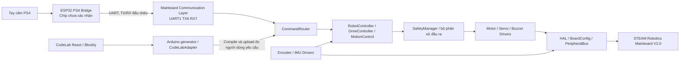

# Kiến trúc firmware và CodeLab - đề xuất Phase 01

Ngày: 2026-11-04. **Phần lớn kiến trúc dưới đây vẫn là đề xuất; cập nhật Phase 02.2 bên dưới xác định phần đã có.** Nền web đang tồn tại được mô tả ở [kiến trúc ứng dụng](../ARCHITECTURE.md); không thay thế ứng dụng bằng một scaffold mới. Arduino C++ vẫn là MVP, React/Vite/Blockly vẫn là nền tảng browser-first. Không bổ sung MicroPython hoặc Scratch VM.

## Triển khai Phase 02.2 — 2026-11-05

`firmware/mainboard/` là sketch Arduino CLI, gồm `BoardConfig.h`, `SafeStartup.h` và `mainboard.ino`. BoardConfig giữ mapping H1 cố định, unique physical reservations và expansion aliases; static assertions chặn map sai phạm vi/trùng GPIO. Không khởi tạo bus từ cấu hình.

SafeStartup có interface I/O nhỏ (template) để chạy fake trên host. Arduino adapter dùng ESP-IDF GPIO API: servo về INPUT/GPIO_FLOATING; nạp latch LOW cho toàn bộ 12 input motor và buzzer trước khi bật bất kỳ output nào. Không dùng Arduino digitalWrite để preload vì cần ghi latch trực tiếp trước direction. Mọi lời gọi trả về lỗi đều giữ trạng thái init không thành công; lỗi preload/Hi-Z không bật output. Lỗi đổi direction có thể để một số chân thành output LOW, không armed. Gọi lại cùng instance là no-op, trả kết quả lần đầu; chỉ dùng một instance trong setup, trước drivers/tasks. Không có API enable/arming/PWM trong phase này.

`setup()` thực hiện startup, giữ kết quả trong instance; `loop()` chỉ `delay(1000)` để nhường scheduler. Không có UART/IMU/encoder initialization. PS4 UART CSV v1 vẫn nguyên hợp đồng và chưa có parser/bridge mainboard.

USB-only vẫn không phát PWM hoặc enable tải; firmware không suy đoán nguồn USB hay nguồn servo. Servo chỉ có thể được enable ở phase sau sau lệnh tường minh và điều kiện nguồn có thể kiểm chứng; chưa có POWER_GOOD. Phần mềm chỉ đặt trạng thái sau khi CPU chạy, không bảo đảm mức điện lúc reset/trước GPIO init; cần kiểm tra pull-state/PCB và waveform thực tế. Host tests xác minh các thao tác được yêu cầu, không đo điện áp/chuyển động thật.

Bằng chứng và giới hạn: [báo cáo Phase 02.2](../verification/PHASE02_2_TEST_REPORT.md). Các lớp còn lại dưới đây là kiến trúc dự kiến, chưa phải chức năng đã chạy.

## Hai firmware độc lập

Mũi tên CodeLab thể hiện mã được sinh và tích hợp khi build, không khẳng định đã có live command protocol. Bridge chỉ chuyển trạng thái tay cầm; mainboard quyết định chuyển động. Hai firmware có build target, dependencies, artifact/version và quy trình upload riêng. Không nạp binary PS4 bridge lên S3 hoặc ngược lại.

## Bảy lớp và ranh giới

| Lớp | Trách nhiệm đề xuất | Ranh giới |
|---|---|---|
| Hardware Abstraction Layer | BoardConfig cố định theo H1; GPIO/PWM/time/serial/bus abstraction; quyền sở hữu pin và tài nguyên | Phần phụ thuộc Arduino/ESP32 nằm sau interface; fake clock/transport/I/O dùng kiểm tra trên host |
| Peripheral Drivers | TMI8260 hai input, servo, quadrature encoder, QMI8658B, buzzer | Không đọc Blockly/PS4; không quyết định chiến lược robot; lỗi trả về có trạng thái |
| Communication Layer | UARTBridge, PacketProtocol, SerialCLI, Diagnostics transport | Parser hữu hạn, không blocking vô hạn; gói hợp lệ mới cập nhật freshness; CLI debug tách link PS4 |
| Robot Control Layer | CommandRouter, RobotController, DriveController, MotionControl | Lệnh dùng kênh motor/servo logic, không dùng GPIO tùy ý; kinematics/PID chỉ sau dữ liệu cơ khí |
| Safety Manager | Quyền cho phép đầu ra; boot/disarmed/armed/fault; freshness, timeout, giới hạn, lỗi nguồn/driver khi có khả năng quan sát | Tất cả đường lệnh, kể cả generated code, CLI và PS4, phải qua cùng gate; không suy ra có cảm biến nguồn hoặc E-stop vật lý |
| CodeLab Integration | Board profile, block semantics, Arduino generator gọi firmware API, diagnostics và workspace migration | Không để UI quyết định chân tự do trên board profile; giữ dự án cũ, chuyển đổi có phiên bản/cảnh báo |
| PS4 Bridge Firmware | Gọi PS4Bluepad32, đọc/chuẩn hóa snapshot, ánh xạ nút, phát trạng thái kết nối/freshness qua UART | Không link MotorDriver/ServoDriver; không chạm GPIO mainboard; không giả định chip bridge |

## Các interface cần thiết kế ở Phase 02+

Đây là hợp đồng trách nhiệm, chưa phải header hay code đã tồn tại:

- BoardConfig cung cấp signal -> GPIO, alias connector, capabilities và reserved pins; báo lỗi nếu trùng chủ sở hữu. Cấu hình module N8 không lấy từ ví dụ generic.
- HAL cung cấp thao tác I/O, monotonic time, PWM resource allocation và transport có timeout. Test dùng implementation giả lập rõ ràng, không tuyên bố giả lập là hardware pass.
- Driver nhận ID kênh và giá trị đã kiểm tra; phân biệt coast/brake, disable servo/giá trị xung, trạng thái sensor valid/stale/error. Encoder chưa được tự gán vào motor nào.
- UARTBridge vận chuyển byte; PacketProtocol quyết định framing/version/sequence/integrity/field ranges. ControllerState chứa validity, connected, thời điểm nhận, trục/nút; trigger analog là quyết định protocol còn mở.
- CommandRouter quản lý quyền sở hữu điều khiển (PS4, generated program, CLI), ưu tiên/cancel/stop. RobotController không được bỏ qua SafetyManager.
- SafetyManager trả quyền đầu ra và lý do từ chối, reset/re-arm rõ ràng. Driver còn phải giữ giới hạn cục bộ để tránh đường gọi ngoài router.
- Diagnostics ghi build/board/protocol version, lỗi parser, sequence gap, disconnect, fault; không trộn log ASCII tùy ý vào UART1 packet stream.

## Vòng đời khởi động và điều khiển đề xuất

1. Boot: thực hiện yêu cầu H1 - 12 motor inputs và buzzer LOW; không phát servo. Xác minh giới hạn phần mềm trước khởi động bằng schematic/đo riêng.
2. Init HAL/driver: nhận diện cấu hình, thiết lập tài nguyên; lỗi giữ trạng thái DISARMED/FAULT. Không có chuyển động ngầm khi init.
3. DISARMED: chỉ cho diagnostics và nhận trạng thái; không tái dùng lệnh cũ sau reset/reconnect. Power readiness chưa rõ thì không enable servo.
4. ARM: thao tác tường minh và kiểm tra readiness/freshness/neutral theo chính sách được chốt; chưa đặt thời gian ổn định nguồn tùy ý.
5. ARMED: scheduler có thời hạn xử lý, đọc encoder/IMU, nhận lệnh, clamp, safety gate, áp dụng đầu ra. Không để `delay()` hoặc vòng lặp Blockly vô hạn làm mất kiểm soát an toàn.
6. FAULT/link loss/stop: vô hiệu lệnh cũ; yêu cầu boot-safe mặc định là motor LOW/coast. Lựa chọn phanh hay giữ/thả servo khi lỗi runtime cần đánh giá cơ cấu và nguồn; chưa tuyên bố LOW an toàn cho mọi cơ cấu treo tải. Reconnect không tự re-arm.

Safety boot tối thiểu phải có từ Phase 02; Phase 05 hoàn thiện chính sách robot. Không đợi Phase 05 mới nghĩ tới trạng thái đầu ra an toàn.

## Tài nguyên và build đề xuất

- Mainboard: Arduino C++ trên ESP32-S3-MINI-1-N8; cần pin phiên bản Arduino core, board/FQBN, flash/partition/USB CDC. Generic `esp32:esp32:esp32s3` trong bridge web chưa phải board profile được xác nhận.
- PS4 bridge: Arduino API của PS4Bluepad32 cần package ESP32 + Bluepad32. Chọn exact board/core/package sau khi có chip. Không mặc định PlatformIO `framework=arduino` cung cấp Bluepad32.
- PlatformIO có thể tổ chức hai target độc lập ở phase sau nếu chứng minh được build reproducible; hiện không có `platformio.ini`. Chưa tạo thư mục firmware hoặc thêm dependencies trong Phase 01.
- 6 motor và 6 servo đòi hỏi kế hoạch PWM/timer toàn hệ thống: motor và servo có tần số khác nhau; không lấy PWM 5 kHz/8-bit generic làm cấu hình servo. Đánh giá LEDC/MCPWM/tài nguyên của core được pin trước khi chọn, không hứa đủ kênh chỉ từ số GPIO.
- I2C 8/9 dùng chung IMU và hai header; một PeripheralBus quản lý init, địa chỉ và timeout. UART1 6/7 chỉ link bridge; USB19/20 dành native; SerialCLI dùng USB hoặc UART0 sau khi chọn cấu hình.

## Tích hợp với ứng dụng hiện hữu

Hướng đề xuất là generated Arduino gọi API mainboard và SafetyManager trong sketch đã build, giữ mô hình compile/upload của CodeLab. Chưa chọn giao thức live điều khiển robot từ browser; không giả định SerialMonitor đã là SerialCLI firmware.

Giữ nguyên `codelab.projects.v1` và file version 1 ở Phase 01. Phase 06 phải định nghĩa profile/version migration, golden fixtures và cảnh báo cho block H-bridge ba chân/UART16/17 cũ. Không đổi ngầm nội dung dự án người dùng. Thay đổi generator cần deterministic code, helper ổn định và source/block mapping khi khả thi.

## Trạng thái

Ngoài BoardConfig/SafeStartup và sketch Phase 02.2 mô tả ở trên, các lớp firmware còn là thiết kế. Chỉ web editor, generator generic và local Arduino CLI bridge có code trong repository. Bộ sinh PS4 đang lỗi khi kiểm tra headless; xem [audit](../PHASE01_AUDIT.md), [module gaps](MODULES.md), [kế hoạch](../IMPLEMENTATION_PLAN.md).
