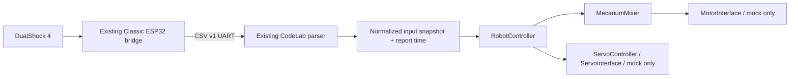
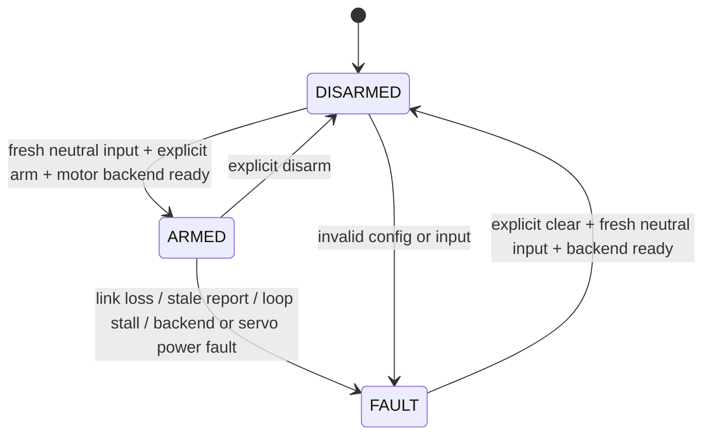

# PS4 mecanum controller — simulation only

Later same-day integration work adds a [mainboard demo and UART rewire candidates](../../firmware/demos/newmania_ps4_mecanum/README.md). RZ7899 reference truth table is now verified; actual Octal PCB motor routing remains unresolved and hardware actuators stay blocked. [Current build/test evidence](../verification/WORKING_MECANUM_DEMO.md). Logic below remains unchanged.

2026-11-05, baseline `d91502c36c96a1baf8d4f4183b687ef8249c0e1c`, initially clean. User authorizes logic/interfaces/mocks/tests and safe compile-only, not uploads or profile changes. Prior stopped hardware session stays stopped.

## Implemented boundary

`firmware/libraries/CodeLabRobot/src/` contains portable C++ (no Arduino dependency): MecanumMixer, RobotController, ServoController, MotorInterface/ServoInterface, MockMotors/MockServo and PS4 mapping/snapshot adapter. No physical motor/servo backend, GPIO assignment, voltage sensing, POWER_GOOD, PWM pulse or Bluetooth implementation was added. Current experimental board remains actuator-blocked. Logical simulation ARMED is not hardware arm permission.



Bridge firmware and publisher are unchanged. The canonical parser template in `src/generators/arduino.js` adds only read-only `hasReport()` and `lastReportAt()` accessors and an export for reuse; parsing, timeout, normalization and CSV v1 bytes are unchanged. `snapshot()` copies normalized data and accepted-report timestamp, never refreshes timestamps or modifies parser axes. Generated `GeneratedPs4Parser.h` is derived from that template by `node tools/robot-parser-header.mjs`, verified byte-for-byte by a regression test. PS4 golden receives the same two methods. Header still contains legacy I2C methods because it is the canonical parser; this task uses UART only and does not initialize Wire.

## Mixing and control coordinates

Logical wheel order: front-left (FL), front-right (FR), rear-left (RL), rear-right (RR). Proposed mathematical coordinates: vx forward, vy left, omega counterclockwise; X-roller arrangement. Positive input sign is a software convention until the actual joystick orientation, wheel mounting and motor polarity are verified. Do not treat these equations as a verified chassis configuration.

```text
FL = vx - vy - omega
FR = vx + vy + omega
RL = vx + vy - omega
RR = vx - vy + omega
```

Divide all wheels by max(1, peak absolute wheel magnitude), then multiply by speedLimit. `MixerConfig.wheelAtOutput` is an explicit permutation of FL/FR/RL/RR into four backend slots; `inverted[slot]` reverses a slot. Defaults identity, no inversion, limit0.5. Limit must be finite in[0,1]; duplicate/invalid roles, NaN/Inf return failure and zero results. Commands are normalized floats, not volts, PWM duty or RPM; no driver truth table implied.

Control mapping: **vx=Left Y, vy=Left X, omega=Right X**, parser axes divided by1000. No additional Y inversion. Default extra deadzone0.08 (configurable) rescales remaining range continuously; it is applied only to a snapshot, independently of library/bridge deadzone. Proposed coordinate signs and slot permutations must be reviewed before physical movement. Per-output acceleration limiting defaults1 normalized unit/second, reversal included. dt is capped at50ms per tick (configurable1..250ms); this prevents a long pause causing a large command jump. Safety stops bypass ramp and immediately disable all mock outputs.

## States, explicit controls and freshness



- Optional PS4 command binding proposal implemented by `Ps4ControlMapping`: **Options rising edge -> arm**, **Share -> disarm**, **PS -> clear fault**. These are software defaults, not owner-approved physical safety controls. Commands can also be supplied explicitly via `Requests`.
- Boot emits no movement and no servo enable. Arm requires all commanded motion within deadzone and D-pad up/down released. The arm transition itself emits no actuator command; a later tick can move the mock.
- The first connected input seeds button state, suppressing held Options on connect/reconnect. Release/press is needed. Reconnection does not clear a fault or arm. Fault-clear and arm cannot happen in the same tick. Share while FAULT stops outputs but does not clear the fault.
- Watchdog is fixed at **elapsed since last valid connected report >250ms**. Exactly250ms remains fresh to match CSV v1. No frame, explicit disconnect or stale link cannot arm; if previously ARMED, enters latched FAULT. Cached polling/malformed lines cannot extend freshness. uint32 subtraction handles millis rollover.
- A tick gap >250ms while ARMED also faults even if a newer input is available when execution resumes. This is a cooperative software watchdog; it acts when tick executes, not an independent interrupt/E-stop or a measured250ms physical stop guarantee. Call parser/update/controller regularly; current compile sketch yields10ms.
- Invalid configuration/input and backend failure disable outputs. Recovery needs fresh/neutral clear then a separate explicit arm; no queued old wheel command survives stop.
- CSV v1 has no sequence/authentication, and cannot detect replay of valid old CSV. Publisher must keep the existing report-freshness gate. No parser, watchdog or mixing logic can prove RF freshness against arbitrary replay.

## Servo logical policy

Default DISABLED. D-pad Up/Down only changes angle after ARMED **and** explicit `Requests.enableServo` **and** `servoPowerConfirmed=true` with backend ready. There is intentionally no automatic PS4 binding for enable. The compile-only sketch always passes false and has only a mock backend. `servoPowerConfirmed` is an input from a future independently verified power policy, not evidence of a documented power-good GPIO or a boolean permission to bypass hardware review.

Default logical bounds0..180°, initial90°, rate45°/s; configurable and validated. Both D-pad directions together cancel. Servo power loss while enabled faults/disables all outputs; disconnect/disarm/fault always disables servo. The stored logical angle is retained while disabled; explicit future enable writes that angle to the mock only. Physical enable/release/hold, pulse range, current and safe initial pose remain undefined and must be reviewed before any real backend; logical bounds are not verified mechanical limits.

## Running host simulation and compile-only

```powershell
npm test
Get-Content firmware/tests/build-output/mecanum/simulation.log
npm run build
node tools/robot-parser-header.mjs
pwsh -NoProfile -File tools/verify-mecanum.ps1
```

The native scenario test compiles `tests/mecanum-native.cpp` with installed g++ C++17/Wall/Wextra/Werror. It includes the actual bridge MappingPublisher and actual parser template under fake serial/clock, then runs the real controller against mocks. The resulting executable/log are under ignored build-output. Covers4913 mixer vectors plus basis/golden/permutation/inversion/saturation/config cases, deadzone/reversal/ramp,250/251ms/wrap/stall, held/reconnect/arm/disarm/fault reset, servo bounds/power loss and backend faults. Arduino INPUT macro is defined during host compile to guard the collision found below.

`firmware/verification/ps4_mecanum_sim/` includes the real parser and portable library with mocks. Serial debug115200 only; **no UART begin, GPIO startup, servo/motor backend or automatic arm**. Without verified UART wiring it intentionally remains DISARMED. It is not a ready-to-drive sketch and not a new board profile. UART application integration is proven in host scenarios, not enabled on the experimental board.

Compile script uses CLI1.5.1/Core3.3.7 and unchanged experimental profile `esp32:esp32:esp32s3:FlashSize=16M,PartitionScheme=default_8MB,PSRAM=opi,USBMode=hwcdc,CDCOnBoot=cdc`, with `--library firmware/libraries/CodeLabRobot`. Data/downloads are process-local Arduino15/staging. No installs, COM enumeration/open, upload, PSRAM disabling or toolchain updates. Internal header library is project source, not an external dependency or vendored PS4 library.

## Verification results

- Host regression **34/34 PASS, exit0**; all five native simulation groups PASS.
- Production build **PASS, exit0**,62 modules; existing bundle-size and Blockly deprecation warnings remain.
- First Arduino compile FAIL/exit1: `Fault::INPUT` collided with Arduino INPUT macro. Renamed to INVALID_INPUT and guarded in host compile. Original failure local log `docs/verification/mecanum_first_compile.log` retained/ignored.
- Final Arduino compile **PASS, exit0**: CLI1.5.1/Core3.3.7, unchanged16MB/OPI profile above. Program341078 /3342336 B (10%), globals24220 /327680 B (7%), remaining303460 B. BIN341232 B, SHA256 `B86B616ECE6B4F0DFDD0FBCF01C6AA79A2B9D058AA442E23C2A04A2B47991CB9`. Raw command/core/output/exit/hash: local `docs/verification/mecanum_compile.log` ignored. Internal library and built-in Core Wire3.3.7 used; no external library installation.
- No hardware tests or uploads in this task. No change to any accepted board profile/startup, native V1/V2 or bridge firmware; no GUI/workspace format changes.

## Wiring and physical backend gates — unresolved

| Item | Evidence / required confirmation | Current policy |
|---|---|---|
| Actual module/PCB | Flash16MB/OPI PSRAM8MB observed previously; exact suffix/revision not verified | Preserve experimental profile; no automatic remapping |
| Motor pins | Old V1 map35–42 conflicts with possible Octal memory35–37 | No output35–37, no four-motor hardware program, no disabling PSRAM to reclaim pins |
| Motor channels/order | Confirm actual schematic/continuity, driver model/truth table, FL/FR/RL/RR, polarity and roller orientation | Logical slots/mock only; no GPIO backend or driver implementation |
| Motor power | Board DC3–15V does not establish safe supply for kit3–6V motors; verify supply routing, protection/current/loads | No DC/motor tests |
| Servo | Confirm signal pin, supply voltage/current, GND, mechanical limits/initial pose and independently verifiable power stability | Mock only, disabled by default; no pulse/attach |
| UART mainboard | V2 documented TX6/RX7; old V1 TX18/RX21 not verified for actual Octal PCB | Experimental profile still blocks UART; no UART init in sketch |
| UART bridge | Classic chip/model, actual TX/RX, supply input still unknown | Existing bridge defaults unassigned; do not infer mainboard pins for bridge |
| Wiring levels | Cross TX/RX, common GND,3.3V signals; verify supplies separately | No +5V_Core connection to unverified bridge input |
| Safety validation | Physical stop latency, E-stop availability, current/thermal/ramp/braking/servo hold policy and input signs | No hardware safety acceptance or robot release claim |

## Acceptance and next task

**SOFTWARE_ACCEPTED** applies to tested pure logic and mock pipeline. **HARDWARE_ACTUATION_BLOCKED** remains for this board. Next task only on a new request: establish actual wiring/power/driver truth table and backend safety contract, then separately authorize hardware work. No A5, Web Pairing, driver implementation or automatic upload follows this task.

## Commit-ready summary

Implemented portable logic/interfaces/mocks and real publisher/parser host integration, no hardware backend. Original board profiles and accepted firmware/bridge unchanged; only parser metadata/API and its golden updated. Verification:34/34 tests, web build and final Arduino compile PASS/exit0; first macro collision fixed. `git diff --check`, document links, ignored artifacts and protected-source diff checked before handoff.

Files created/modified (23):

- `.gitignore`
- `AGENTS.md`
- `README.md`
- `docs/IMPLEMENTATION_PLAN.md`
- `docs/PROGRESS.md`
- `docs/PS4-RECEIVER.md`
- `docs/TESTING.md`
- `docs/architecture/ARCHITECTURE.md`
- `docs/robotics/PS4_MECANUM.md`
- `firmware/libraries/CodeLabRobot/library.properties`
- `firmware/libraries/CodeLabRobot/src/Actuators.h`
- `firmware/libraries/CodeLabRobot/src/CodeLabRobot.h`
- `firmware/libraries/CodeLabRobot/src/MecanumMixer.h`
- `firmware/libraries/CodeLabRobot/src/Ps4ControlMapping.h`
- `firmware/libraries/CodeLabRobot/src/RobotController.h`
- `firmware/verification/ps4_mecanum_sim/GeneratedPs4Parser.h`
- `firmware/verification/ps4_mecanum_sim/ps4_mecanum_sim.ino`
- `src/generators/arduino.js`
- `tests/fixtures/ps4_uart.ino`
- `tests/mecanum-native.cpp`
- `tests/mecanum.test.mjs`
- `tools/robot-parser-header.mjs`
- `tools/verify-mecanum.ps1`

Excluded: `node_modules/`, `dist/`, firmware `build-output/`, BIN/ELF/map/executables, host `simulation.log`, raw `docs/verification/mecanum_*.log`. No external library vendoring or tracked binary. No commit/push performed.

Suggested conventional commit and exact commands for the owner:

```powershell
git add -- .gitignore AGENTS.md README.md docs/IMPLEMENTATION_PLAN.md docs/PROGRESS.md docs/PS4-RECEIVER.md docs/TESTING.md docs/architecture/ARCHITECTURE.md docs/robotics/PS4_MECANUM.md firmware/libraries/CodeLabRobot/library.properties firmware/libraries/CodeLabRobot/src/Actuators.h firmware/libraries/CodeLabRobot/src/CodeLabRobot.h firmware/libraries/CodeLabRobot/src/MecanumMixer.h firmware/libraries/CodeLabRobot/src/Ps4ControlMapping.h firmware/libraries/CodeLabRobot/src/RobotController.h firmware/verification/ps4_mecanum_sim/GeneratedPs4Parser.h firmware/verification/ps4_mecanum_sim/ps4_mecanum_sim.ino src/generators/arduino.js tests/fixtures/ps4_uart.ino tests/mecanum-native.cpp tests/mecanum.test.mjs tools/robot-parser-header.mjs tools/verify-mecanum.ps1
git diff --cached --stat
git diff --cached --check
git commit -m "feat(robotics): add simulated PS4 mecanum controller and safety tests"
git push origin codex/integrate-bach-ui
```
