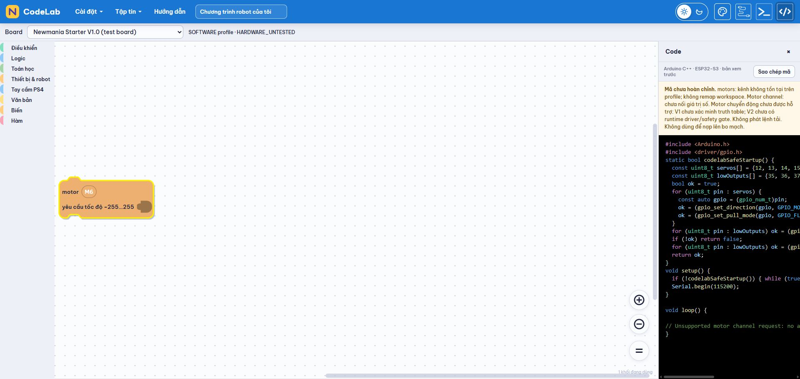

# Robotics Blocks & Generator Integration — 2026-11-05

Baseline: `b386d99fef545fc56b2da1ec7418c1fcbd490ba3`, branch `codex/integrate-bach-ui`, initially clean. Windows local, existing Node/npm dependencies, Arduino CLI 1.5.1 (`01f3d4f2b`), `esp32:esp32` Core 3.3.7 directly checked. No dependency/core installation, system configuration change, port selection, upload, hardware test, commit or push.

## Scope and block audit

| Block / feature | Existing implementation | Result in this task / remaining gap |
|---|---|---|
| Digital write/read | Blocks and generator existed | Retained, profile pin/mode checks and compiled V1 examples; added no-pull/pull-up/pull-down read block |
| ADC | Block and generator existed | Retained; V1/Generic capability, V2 hidden/invalid pins diagnosed; V1 generated code compiled |
| PWM | Core 3 `ledcAttach`/`ledcWrite` existed | Retained duty clamp 0–255; V1 LED47 compiled, conflicts diagnosed, V2 hidden; no motor/servo PWM |
| Delay | Block existed | Now follows full statement chain; negative durations clamp to zero |
| Serial | `text_print` existed | Added print/println, available/read (-1 when empty); existing Serial115200, escaped text and standalone expressions compile |
| Legacy H-bridge | Generic raw IN1/IN2/PWM block existed | Preserved for legacy Generic workspaces; concrete boards reject it. No claim of verified V1/V2 motion support |
| Motor channels | Missing | Added logical channel API M1–M4 V1/M1–M6 V2; **unsupported diagnostic**, no actuator command generated |
| Servo write | Missing | Added channel/angle API; **unsupported diagnostic**, no attach, enable or pulses |
| Servo disable | Missing | Added profile channel -> GPIO signal INPUT/FLOATING; compile verified. Does not switch power or establish safe mechanical release |
| Sensors | Digital/ADC primitives only | No dedicated IMU/encoder/range blocks or runtime drivers; remain future scope |

No V1 truth table or servo power interlock was inferred. V2 runtime motor/safety drivers are not implemented. No POWER_GOOD, stabilization timer or boolean override was invented. Safe startup still acts after CPU boot, not as protection before GPIO initialization. Hardware electrical/mechanical validation remains pending.

## Shared generator defects corrected

The default generator did not append `nextConnection` statements. A sequence previously emitted only its first block; Blink omitted delay/LOW and PS4 UART omitted connected/axis/button prints. `scrub_` now traverses the chain, including nested statements, with `thisOnly` honored. `scrubNakedValue` adds the missing C++ semicolon for top-level expressions. These are user-visible correctness fixes; historical compile success did not establish the omitted behavior.

Five derived V1 `.ino` examples and the PS4 UART golden were regenerated. Their JSON workspaces, native V1/V2 startup firmware, board registry/mappings and PS4 Bridge are unchanged. No UART CSV v1/parser/publisher code changed. Includes are deduplicated so servo-disable and startup share `driver/gpio.h` once.

## Profiles, compatibility and examples

Toolbox generation uses registry capabilities. Channel values 1–6 remain serializable across profiles: V1 marks M5/M6 and S5/S6 unsupported, Generic has no mapped channels. Unsupported values are diagnosed, never rewritten. Legacy block types remain registered even when absent from a profile's toolbox. Format `codelab-project` version1 and optional `project.boardId` are unchanged; missing boardId still selects Generic.

Examples in `firmware/verification/robotics_examples/`, regenerated with `npm run examples:robotics`:

- `v1_io_serial`: GPIO4 LOW, GPIO1 pull-up input, ADC2, LED47 PWM duty32, Serial available/read/text, delay250. Compile fixture, not permission to connect arbitrary loads.
- `v2_serial_servo_disabled`: disable all six servo signals plus Serial/delay, no pulses or motion.
- `generic_serial`: Serial/read/available/text/delay and floating expression syntax.
- `v1_motor_request_unsupported`, `v1_servo_request_unsupported`, `v2_motor_request_unsupported`: JSON-only negative workspaces; warnings intentionally prevent compilation. No executable load-control artifact supplied.

Browser smoke: Chrome opened the local Vite app, V2 toolbox showed channel Motor/Servo and no ADC/PWM; M6 -> V1 retained M6 and displayed invalid-channel/unsupported-motion warnings. The temporary test block was removed and the initially empty Generic workspace restored. Host tests cover serialized board switching, pin conflicts, legacy projects and stale build/profile upload guards. No device operation occurred.



## Verification

- `npm test`: **27/27 PASS, exit0** (19 existing plus8 regression tests).
- `npm run build`: **PASS, exit0**, Vite7.3.7, 62 modules, JS1,043.68kB / gzip286.49kB. Existing bundle-size warning and Blockly variable API deprecation remain.
- `node tools/verify-robotics-build.mjs`: compile-only workspace -> generator -> HTTP bridge -> real Arduino CLI -> nonempty BIN. **10/10 PASS, script exit0**; each HTTP200 requires actual compiler exit0 and a nonempty binary. Local raw stdout/stderr, HTTP result, profile/FQBN, memory and script exit code: `docs/verification/robotics_blocks_compile.log` (ignored).
- CLI version and core list were run directly; installed Core3.3.7 selected, available update3.3.12 not installed. Bluepad32 core not used for these ESP32-S3 builds.

Exact compiler environment (PowerShell, process-local):

```powershell
$env:ARDUINO_CLI_PATH = 'C:\Users\Admin\AppData\Local\Programs\Arduino IDE\resources\app\lib\backend\resources\arduino-cli.exe'
$env:ARDUINO_DIRECTORIES_DATA = 'C:\Users\Admin\AppData\Local\Arduino15'
$env:ARDUINO_DIRECTORIES_DOWNLOADS = 'C:\Users\Admin\AppData\Local\Arduino15\staging'
& $env:ARDUINO_CLI_PATH version
& $env:ARDUINO_CLI_PATH core list
node tools/verify-robotics-build.mjs
```

The HTTP service validates installed core version and invokes `arduino-cli compile --fqbn <profile FQBN> --output-dir <temporary output> <temporary sketch>`. It never invokes upload. V1: `esp32:esp32:esp32s3:FlashSize=8M,PartitionScheme=default_8MB,PSRAM=enabled,USBMode=hwcdc,CDCOnBoot=cdc`; V2: same base with `FlashSize=8M,PartitionScheme=default_8MB,PSRAM=disabled`. Generic retains unmodified `esp32:esp32:esp32s3` defaults; do not interpret its default flash partition as V1/V2 configuration.

| Example | Program B | Globals B | BIN B | Result / CLI exit |
|---|---:|---:|---:|---|
| v1_io_serial | 330145 | 22564 | 330288 | PASS / 0 |
| v2_serial_servo_disabled | 287403 | 21428 | 287552 | PASS / 0 |
| generic_serial | 285331 | 21428 | 285472 | PASS / 0 |
| legacy_v1_minimal | 311846 | 22164 | 312000 | PASS / 0 |
| legacy_v1_blink | 311898 | 22164 | 312048 | PASS / 0 |
| legacy_v1_serial_hello | 311986 | 22164 | 312128 | PASS / 0 |
| legacy_v1_digital_input | 312254 | 22164 | 312400 | PASS / 0 |
| legacy_v1_adc_read | 322178 | 22444 | 322320 | PASS / 0 |
| legacy_v1_pwm_led | 319713 | 22308 | 319856 | PASS / 0 |
| ps4_uart_chain | 313651 | 22988 | 313792 | PASS / 0 |

All V1/V2 builds used 8MB flash/default_8MB; PSRAM QSPI enabled on V1 and disabled on V2. Program limits3,342,336 B and RAM327,680 B; Generic keeps legacy default partition limit1,310,720 B. Compiler maximums are accounting limits, not measured physical RAM/flash. `git diff --check` and49 relative documentation links PASS; no native V1/V2/profile/Bridge diff, staged changes or tracked firmware binaries.

**SOFTWARE_ACCEPTED** for the supported blocks and software diagnostics above. **HARDWARE_UNTESTED** remains.

## Commit-ready scope

Changed: three existing editor/block/generator files, new profile toolbox,8 regression tests, example-generation/compile scripts,6 new example workspace folders (3 supported C++ files),5 regenerated V1 C++ examples, PS4 golden, package script, ignore policy, agent/readme/progress/plan/testing/profile documentation and this report/screenshot. No dependencies added.

Files to commit (32; initially clean workspace):

- `.gitignore`
- `AGENTS.md`
- `README.md`
- `docs/IMPLEMENTATION_PLAN.md`
- `docs/PROGRESS.md`
- `docs/TESTING.md`
- `docs/boards/BOARD_PROFILES.md`
- `docs/verification/ROBOTICS_BLOCKS_INTEGRATION.md`
- `docs/verification/robotics_profile_switch.png`
- `firmware/newmania_v1/examples/adc_read/adc_read.ino`
- `firmware/newmania_v1/examples/blink/blink.ino`
- `firmware/newmania_v1/examples/digital_input/digital_input.ino`
- `firmware/newmania_v1/examples/pwm_led/pwm_led.ino`
- `firmware/newmania_v1/examples/serial_hello/serial_hello.ino`
- `firmware/verification/robotics_examples/generic_serial/generic_serial.codelab.json`
- `firmware/verification/robotics_examples/generic_serial/generic_serial.ino`
- `firmware/verification/robotics_examples/v1_io_serial/v1_io_serial.codelab.json`
- `firmware/verification/robotics_examples/v1_io_serial/v1_io_serial.ino`
- `firmware/verification/robotics_examples/v1_motor_request_unsupported/v1_motor_request_unsupported.codelab.json`
- `firmware/verification/robotics_examples/v1_servo_request_unsupported/v1_servo_request_unsupported.codelab.json`
- `firmware/verification/robotics_examples/v2_motor_request_unsupported/v2_motor_request_unsupported.codelab.json`
- `firmware/verification/robotics_examples/v2_serial_servo_disabled/v2_serial_servo_disabled.codelab.json`
- `firmware/verification/robotics_examples/v2_serial_servo_disabled/v2_serial_servo_disabled.ino`
- `package.json`
- `src/blocks/robotics-toolbox.js`
- `src/blocks/robotics.js`
- `src/components/BlocklyWorkspace.jsx`
- `src/generators/arduino.js`
- `tests/fixtures/ps4_uart.ino`
- `tests/robotics.test.mjs`
- `tools/robotics-examples.mjs`
- `tools/verify-robotics-build.mjs`

Excluded: `node_modules/`, `dist/`, binary/ELF/map/host executables/build-output, raw `robotics_blocks_*.log`. CLI bridge artifacts are temporary and ignored/outside Git. Keep the short Markdown report and screenshot as reviewable evidence. Existing ignore rules for logs and build products remain.

Suggested commit: `feat(robotics): add profile-aware blocks and fix statement generation`

Review and run manually in the repository root:

```powershell
git add -- .gitignore AGENTS.md README.md package.json docs/PROGRESS.md docs/IMPLEMENTATION_PLAN.md docs/TESTING.md docs/boards/BOARD_PROFILES.md docs/verification/ROBOTICS_BLOCKS_INTEGRATION.md docs/verification/robotics_profile_switch.png src/blocks/robotics.js src/blocks/robotics-toolbox.js src/components/BlocklyWorkspace.jsx src/generators/arduino.js tests/robotics.test.mjs tests/fixtures/ps4_uart.ino tools/robotics-examples.mjs tools/verify-robotics-build.mjs firmware/verification/robotics_examples firmware/newmania_v1/examples/adc_read/adc_read.ino firmware/newmania_v1/examples/blink/blink.ino firmware/newmania_v1/examples/digital_input/digital_input.ino firmware/newmania_v1/examples/pwm_led/pwm_led.ino firmware/newmania_v1/examples/serial_hello/serial_hello.ino
git diff --cached --stat
git commit -m "feat(robotics): add profile-aware blocks and fix statement generation"
git push origin codex/integrate-bach-ui
```

## Remaining gates / next task

Hardware remains **HARDWARE_UNTESTED / PENDING_HARDWARE_VALIDATION**. Motor movement requires confirmed driver model/truth table, power wiring/voltage and reviewed safety API; servo enable requires verified power-stable condition and safe load policy. V1 input DC3–15V does not establish a safe supply for 3–6V motors. Dedicated sensor drivers, USB/PSRAM runtime and real Serial/GPIO behavior remain unverified.

Next recommendation: a separately scoped sensor-block/API design and host mocks, or an explicit power/driver safety specification before any motion generator. No automatic Phase02.3/A5/hardware task or PS4 Bridge work.
